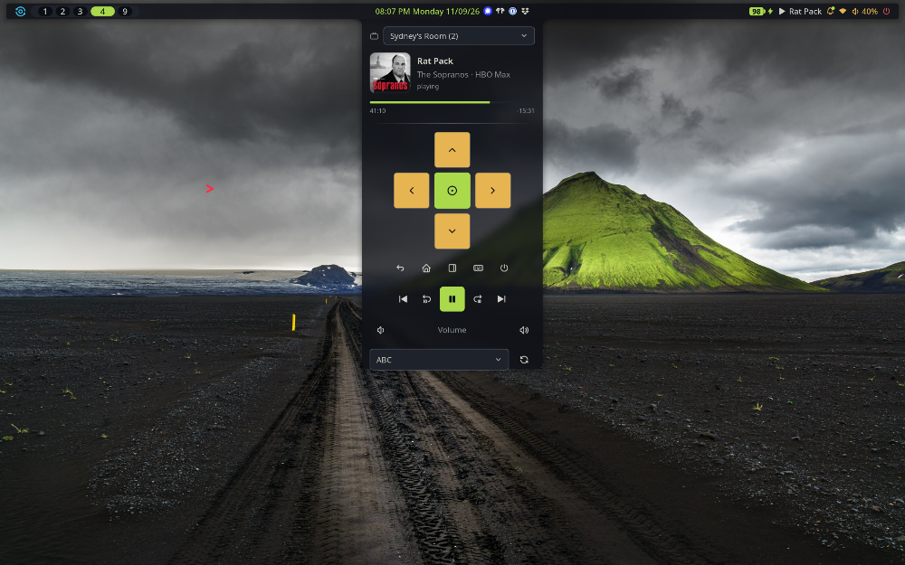

# peard-remote

*An Apple TV remote you pair with — so, a pear'd remote.*

An Apple TV remote for the [Noctalia](https://noctalia.dev) v5 bar, built on
[pyatv](https://pyatv.dev).

  

## Features

- Start, Stop, Play, Pause Apple TVs
- Multiple Apple TV support
- CLI for securely pairing with your Apple TVs
